<picture>
  <source media="(prefers-color-scheme: dark)" srcset="assets/ledger-dark.svg">
  
</picture>

### Selected work

- [Prime Menus](https://prime-menus.com): QR menus for restaurants. Guests scan a code and get a menu that is always current; menus arrive as photos or PDFs and AI builds them.
- [MoviGo](https://apps.apple.com/il/app/movigo/id6770183537): a free iPhone app for picking a cinema screening in Israel, with showtimes, distance and live seat occupancy across five chains.
- [Sijil](https://sijil-memorial.vercel.app): a public register of homicide victims in Arab society in Israel, one record per person, drawn from the Arabic and Hebrew press with the sources behind every name. [Code](https://github.com/FadiBadarni/israel-homicides).
- [iris](https://github.com/FadiBadarni/iris): an MCP server and CLI that grounds AI coding assistants in a Next.js and Tailwind project's design system.

[Prime Systems](https://www.prime-systems.co.il) · [LinkedIn](https://linkedin.com/in/fadibadarni) · [Email](mailto:fadybd1@gmail.com)

The drawing is rebuilt every night by <a href="ledger">a small script</a> from commit times across my repositories, public and private. Only dates and hours are read. The line under "This week" is written by Claude from the week's commit subjects; client work is described by its label alone.
